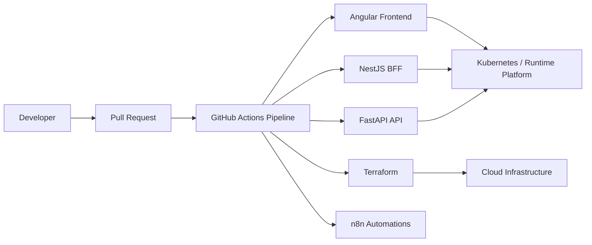

# DevoRecruiter

DevoRecruiter is a source monorepo that combines the application code, runtime assets, automation exports, and infrastructure code for the platform.

The goal of this repository is separation with traceability:

- application code stays in one place
- infrastructure code stays versioned with the platform
- workflow automation is reviewed like normal code
- builds are repeatable from a clean checkout

## Architecture



## Repository Layout

- `apps/frontend/` Angular frontend
- `apps/api-bff/` NestJS backend-for-frontend
- `apps/api-back/` FastAPI service
- `automation/n8n/` sanitized n8n workflow exports
- `infrastructure/terraform/` infrastructure-as-code source
- `.github/workflows/pipeline.yml` primary CI workflow

## Tech Stack

- Frontend: Angular, TypeScript
- Backend: NestJS, FastAPI
- Infrastructure: Terraform
- Automation: n8n
- CI/CD: GitHub Actions

## Local Development

Use the repository-specific commands for each package or service.

Example frontend workflow:

```bash
cd apps/frontend
npm ci
npm run lint:ci
npm run typecheck
npm run test:ci
npm run build
```

## CI/CD

The main workflow should validate the monorepo in a predictable order:

1. lint and typecheck
2. unit or component tests
3. build verification
4. infrastructure validation
5. deployment-safe packaging

## Branching and Commits

- Branches should be named like `feat/<area>`, `fix/<area>`, `docs/<area>`, or `ci/<area>`
- Keep commits small and focused
- Prefer Conventional Commits such as `feat(frontend): add recruiter search panel`
- Use pull requests for reviewable changes instead of pushing directly to `main`

## Contributing

- Make one logical change per commit
- Run the relevant checks before opening a PR
- Keep workflow and infrastructure changes separate from product changes when possible
- Avoid committing secrets, generated artifacts, or local environment files

BFF:

```bash
cd apps/api-bff
npm ci
npm test
npm run build
```

FastAPI:

```bash
cd apps/api-back
python -m venv .venv
.venv\Scripts\activate
python -m pip install --upgrade pip
python -m pip install -r requirements.txt
python -m uvicorn app.main:app --reload
```

## Pipeline behavior

The GitHub Actions pipeline is path-aware. Shared repository controls rerun all relevant chains, while app-specific changes only run the matching chain.

Security gates stay independent:

- frontend publication depends on frontend CI, frontend security, Trivy, and the repository-wide secret scan;
- BFF publication depends on BFF CI, BFF security, Trivy, and the repository-wide secret scan;
- FastAPI publication is intentionally blocked by the current ChromaDB advisory and must not be forced through.

## Docker image strategy

Keep the three service images separate in Docker Hub:

- `benharbfarah/devorecruiter-front`
- `benharbfarah/devorecruiter-api-bff`
- `benharbfarah/devorecruiter-api-back`

Each image is tagged only with the full Git SHA:

```text
${{ github.sha }}
```

No mutable tags are used.

