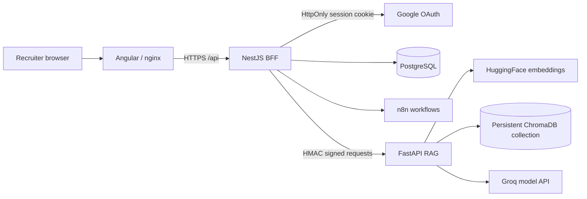
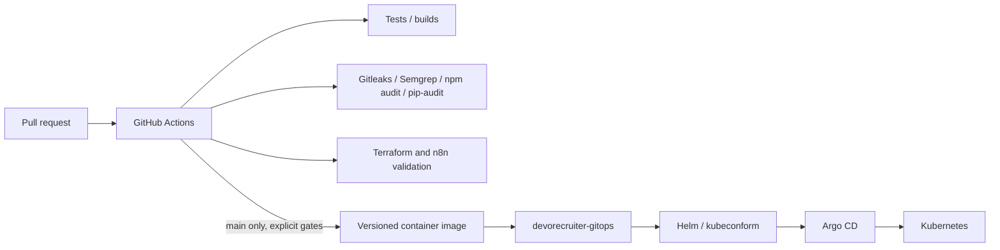

# DevoRecruiter

DevoRecruiter is a recruiting platform monorepo combining an Angular frontend,
a NestJS backend-for-frontend, a FastAPI RAG service, PostgreSQL, and n8n
automation. The project is organized around traceable changes, reproducible
builds, and deployment-safe delivery rather than an assumption of production
availability.

## Application Architecture



The BFF owns browser-facing authentication and service orchestration. OAuth
callbacks return to the frontend without access or refresh tokens in the URL.
Refresh tokens are held in HttpOnly cookies; production configuration requires
Secure cookies and an allowed HTTPS origin.

The RAG service ingests PDF, DOCX, XLSX, and JSON documents, creates HuggingFace
embeddings, stores them in a persistent Chroma collection, and returns answers
with document sources. Retrieval supports MMR and a lexical fallback. The BFF
and FastAPI service authenticate internal requests with a shared HMAC secret
injected at runtime, with timestamp and request-id replay protection.

## Delivery Architecture



The application and GitOps repositories are separate. The GitOps repository
contains five Helm charts and Argo CD Applications. Secrets, certificates,
kubeconfig files, and cloud credentials remain outside Git. Publication and
GitOps update jobs are restricted to the controlled `main` path; pull requests
run validation only.

## Repository Layout

- `apps/frontend/`: Angular frontend and browser session restoration.
- `apps/api-bff/`: NestJS BFF, OAuth, sessions, LangChain v1 agent, and SQL tools.
- `apps/api-back/`: FastAPI ingestion, embeddings, Chroma persistence, and RAG endpoints.
- `automation/n8n/`: sanitized workflow exports.
- `infrastructure/terraform/`: infrastructure-as-code source.
- `.github/workflows/pipeline.yml`: path-aware application CI/CD workflow.

## Technology Focus

- Cloud and platform: Docker, Kubernetes, Helm, Argo CD, Terraform, PostgreSQL.
- Application delivery: GitHub Actions, immutable image references, smoke-test jobs.
- Backend: Angular, NestJS, FastAPI, TypeScript, Python.
- AI platform: LangChain v1, SQL tools, HuggingFace embeddings, ChromaDB, Groq.
- Security: HttpOnly/Secure cookies, CORS allowlists, HMAC service authentication,
  anti-replay checks, external Kubernetes Secrets, Gitleaks, Semgrep, npm audit,
  pip-audit, non-root containers, seccomp, and NetworkPolicies.

## Validation Evidence

The consolidated branch has validated:

- `133` NestJS suites and `957` tests passing before the Python runtime change.
- `12` FastAPI/RAG tests passing, including persistence, reopening, MMR, source
  contracts, isolation, and no-reindex behavior.
- BFF and FastAPI builds, `pip check`, Gitleaks, frontend CI, Terraform validation,
  and n8n validation in GitHub Actions.
- BFF dependency audit with no remaining high or critical findings.
- ChromaDB collection reopening from a fictional legacy `0.6.3` fixture under
  ChromaDB `1.5.9`.

The current FastAPI security gate remains intentionally visible while ChromaDB
advisories have no fixed release in the installed line. `filelock` is being
validated separately on Python 3.11 with its published security release.

## Local Development

Frontend:

```bash
cd apps/frontend
npm ci
npm run lint:ci
npm run typecheck
npm run test:ci
npm run build
```

BFF:

```bash
cd apps/api-bff
npm ci
npm test -- --runInBand
npm run build
```

FastAPI requires Python 3.11 for the current dependency graph:

```bash
cd apps/api-back
python -m venv .venv
.venv\Scripts\activate
python -m pip install --upgrade pip
python -m pip install -r requirements.txt
python -m pip check
python -m pytest tests -q
```

Use fictional credentials for local tests. Do not place provider keys, OAuth
secrets, SMTP passwords, or Kubernetes Secret values in the repository.

## Known Limitations

- No OpenStack, Kubernetes, OAuth HTTPS, or Argo CD deployment has been claimed
  as locally verified.
- Docker smoke tests require a Docker-enabled runner.
- ChromaDB `1.5.9` remains covered by server/API advisories; the application
  uses embedded local persistence and must not expose a Chroma server directly.
- Production readiness still depends on external Secrets, TLS certificates,
  domain/DNS configuration, backups, and a tested rollback procedure.
- The GitOps image digests must be updated only after the consolidated images are
  built, scanned, and published through the approved release path.

## Contribution Rules

- Use small, meaningful Conventional Commits.
- Work through pull requests instead of pushing directly to `main`.
- Keep application and GitOps changes separately reviewable.
- Run relevant tests and security scans before requesting a merge.
- Never commit secrets, generated private data, or local runtime volumes.

